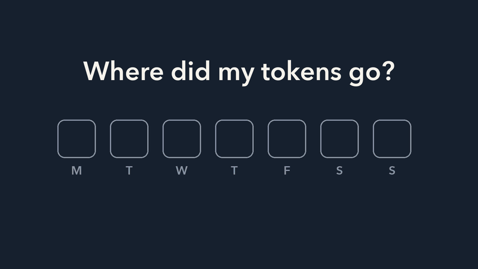
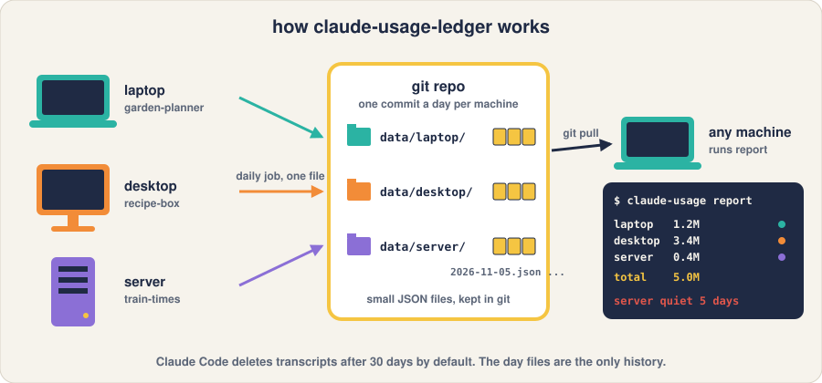
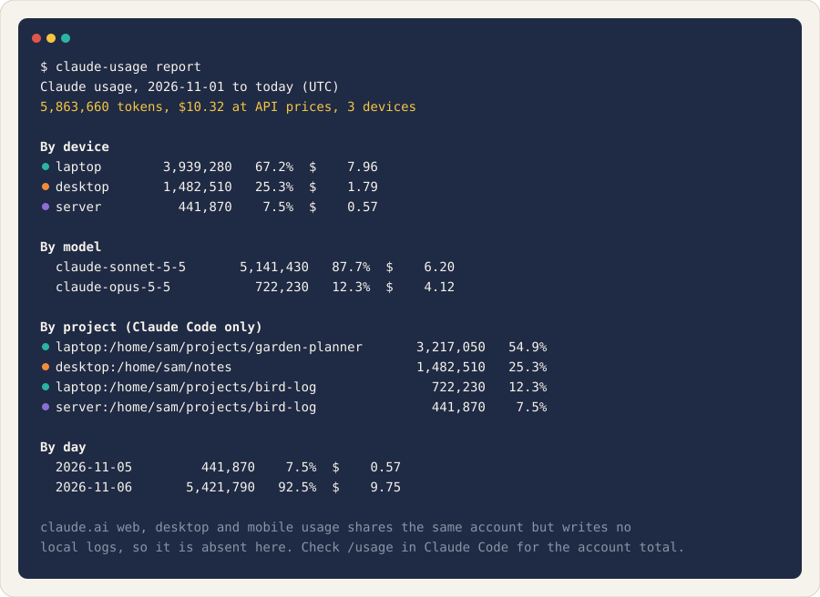

# claude-usage-ledger

A daily, per-machine ledger of where your Claude Code tokens went.



The animation shows three machines each saving one day file into a git repo,
one of them running `claude-usage report`, and the day files outliving the
30-day transcript prune. A still version is at [docs/explainer.png](docs/explainer.png).

Claude Code limits are per account, but the transcripts that show where the
tokens went live on each machine and are deleted after 30 days by default.
claude-usage-ledger runs a small daily job on every machine that reads its
local transcripts, counts tokens per project and per model, and commits one
JSON file per day to a shared git repo. From any machine, `claude-usage report`
pulls that repo and prints totals by device, model, project and day, with a
warning when a machine has stopped reporting.



## How it works

- `collect` runs on each machine from cron. It asks `ccusage` for per-model
  tokens and cost, scans the local Claude Code transcripts for per-project
  tokens, and writes `data/<device>/<date>.json`.
- `sync.sh` commits those files and pushes. Each device writes only its own
  directory, so there is nothing to merge.
- `report` pulls, merges every device's files and prints four tables: by
  device, by model, by project and by day.

The repository is the data store. Make a private copy of it first (Use this
template on GitHub, or fork and set it private), then install on each machine
from that copy. Design notes, including the one dedupe rule that matters, are
in [docs/design.md](docs/design.md).

## Install on each machine

Requirements: Python 3.11 or newer, `npx` (Node), `git` with a user name and
email configured, `crontab`, and a credential that can push to your private
copy.

1. Clone your private copy and enter it.
   `git clone <your-private-copy> claude-usage-ledger && cd claude-usage-ledger`
   Expected: `git remote -v` shows your repository.
2. Run the installer with a short device name. Use the same `--tz` value on
   every machine so days line up.
   `./install.sh laptop --tz Europe/Berlin`
   Expected: `claude-usage.toml` is written, `crontab -l` shows one line for
   this checkout, and the first sync writes `data/laptop/` and pushes.
3. Repeat on each machine with its own device name.

Settings live in `claude-usage.toml`, which is gitignored.
`python3 claude_usage.py config` prints the effective values. Run every
command from the repository directory; `pip install .` adds a `claude-usage`
command that works the same way.

To uninstall on a machine, delete the line for this checkout from `crontab -e`
and remove `claude-usage.toml`.

| Key | Default | Meaning |
|---|---|---|
| `device` | hostname | Name of this machine's data directory. |
| `timezone` | `UTC` | Zone used to bucket days. Set the same value everywhere. |
| `cron` | `17 12` | Minute and hour of the daily sync. |
| `stale_days` | `5` | Warn when a device has not synced for this many days. |
| `drift_warn` | `0.02` | Warn when project totals drift from the Claude Code total by more than this fraction. |
| `transcripts` | `$CLAUDE_CONFIG_DIR/projects` or `$HOME/.claude/projects` | Where Claude Code keeps its transcripts. |
| `ccusage` | `npx -y ccusage@20` | Command that runs ccusage. |

`CLAUDE_USAGE_DEVICE` and `CLAUDE_USAGE_TZ` override the file.

## Daily use

```
python3 claude_usage.py report          # last 7 days, all devices
python3 claude_usage.py report -d 30    # last 30 days
python3 claude_usage.py report -j       # one JSON object
python3 claude_usage.py collect         # write this machine's day files, no push
```



## Limits

- claude.ai web, desktop and mobile write no local logs, so they are absent.
  `/usage` in Claude Code shows the true account total.
- Only Claude Code records a working directory, so other agent CLIs that
  ccusage reads get model and token attribution but no project attribution.
- Cost is the API-equivalent figure from ccusage, not what a subscription
  bills.

## Tests

```
pip install pytest
pytest
```

Fixtures are invented transcripts and day files. ccusage and git are mocked,
so the suite needs neither network nor Node.

## Security

To report a security problem, use the repository's private vulnerability
reporting on GitHub rather than a public issue.

## License

MIT, see [LICENSE](LICENSE).
